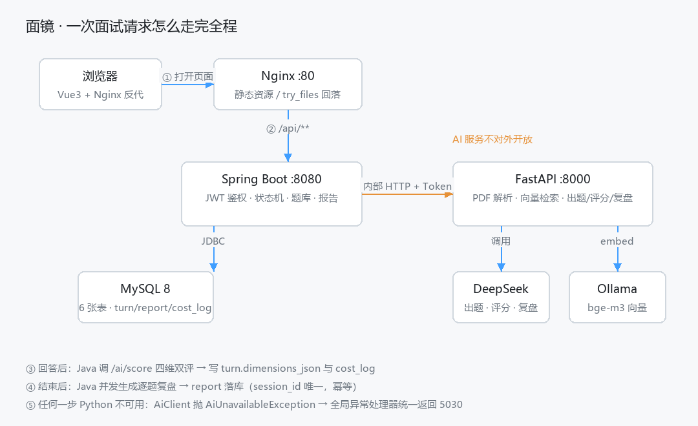

# 面镜 · AI 模拟面试训练系统

上传简历、选岗位，AI 按岗位要求逐题追问，结束后给出四维评分、逐题差距和参考讲法。



## 为什么做这个

练面试只有三条路：对镜子（没人追问）、找同学（对方不懂岗位）、背面经（一追问就露馅）。

真正缺的是：**能按你的简历出题、能顺着你的回答深挖、能说清"差在哪"的陪练**。

## 效果数据（本机实测，可复现）

| 指标 | 数值 | 怎么测的 |
|---|---|---|
| 同一回答两次打分差值 ≤ 1 分 | **100%**（10 条样本 × 3 轮） | `ai/tools/eval_consistency.py` |
| 最大差值 | 0（温度调到 0.8 时 0.5） | 同上 |
| 与人工标注平均差 | **0.60 分** | 同上 |
| 追问引用原话 | **100%**（不引用直接丢弃重出题） | `_cites` 校验 + 单元测试 |
| 单场耗时（八题 + 报告） | **41 秒** | `scripts/e2e.ps1` |
| 单场成本（四维双评） | **0.18 元** | `cost_log` 表 |
| 简历解析 | 真实 PDF 抽到手机号/邮箱/12 项技能/项目 | `scripts/acceptance.ps1` 第 4 条 |

> 一致性为什么是 100%：deepseek-chat 在 `temperature=0` 下对同一输入是确定的，
> 三轮跑下来分数完全一致。常见资料里的「60% → 91%」是在更高温度、更早的模型上测的。
> 本机真正难的反而是「和人工打分对齐」（0.60），细节和实验记录见 [docs/eval-log.md](docs/eval-log.md)。

## 架构

```
浏览器 ──▶ Nginx :80 ──(/api/**)──▶ Spring Boot :8080 ──JDBC──▶ MySQL 8
                                        │
                                        └──内部 HTTP + Token──▶ FastAPI :8000 ──▶ DeepSeek / Ollama(bge-m3)
```

**为什么拆两个服务**

- 业务要事务、并发、鉴权，Java 更稳；PDF 解析、向量检索、提示词编排，Python 生态更全。
- **Python 不连数据库**，上下文由 Java 在请求里传过去。因此 AI 服务是无状态的，可以横向扩容。
- 前端只认 `/api/**`，不知道 Python 的存在 —— AI 服务永远不对外暴露。

## 技术要点

1. **契约隔离**：`docs/ai-contract.md` 定死七个内部接口，两侧可以并行开发。
2. **状态机**：`interview_session` 存轮数/深度/最后一题，追问深度到 2 自动换新题，第八题答完立刻结束（不再多调一次模型）。
3. **评分稳定性**：评分口径（`prompts/rubric.md`）+ 温度归零 + 先列关键点再打分 + 四维双评 + 证据原话校验，低置信度会标出来。
4. **追问不跑题**：追问必须包含候选人回答里的原话片段（`_cites`，短回答 2 字、长回答 3 字），不引用就丢弃、重出一道新题。
5. **降级链路**：Python 挂了 → Java 立刻返回 5030 而不是卡 90 秒；DeepSeek 超时 → 自动切本地 Ollama；简历抽不出 → `needsReview=true` 但面试照常进行。
6. **可测**：`docs/eval-log.md` 记录了三组对比实验（关关键点 / 关双评 / 调温度 / 加 few-shot / 加硬规则），每一步都跑同一份标注集。

## 快速开始

### 方式零：双击两个 bat（推荐）

| 双击 | 作用 | 结果 |
|---|---|---|
| **`start.bat`** | 检查 MySQL → 起 AI（守护模式）→ 起 Java → 起前端 → 逐个健康检查 | 打印入口地址，窗口里每 15 秒一行状态 |
| **`stop.bat`** | 按启动记录杀进程树，再按命令行/端口兜底 | 确认 8000/8080/5174–5185 全部放开 |

细节：

- 端口统一在 **`scripts/ports.ps1`** 里改（默认 AI 8000 / Java 8080 / 前端 5180），Java 侧同步改 `application.yml` 的 `mirror.ai.base-url`。
- 前端固定从 **5180** 起，避开本机被占用的 5173；脚本会从 Vite 输出里读真实地址。
- 关闭 start 的窗口 **不等于** 停服务（子进程会留着），要停就双击 `stop.bat` 或按 `Ctrl+C`。
- `stop.bat` 不碰 5173 及以下端口，不会误杀别的项目。
- 启动记录在 `logs\run.json`，删了也能靠命令行识别兜底。

命令行等价写法：

```powershell
cd "E:\AI Full-Stack Engineer\mirror"
powershell -ExecutionPolicy Bypass -File scripts\start-all.ps1 -WithWeb   # 起
powershell -ExecutionPolicy Bypass -File scripts\stop-all.ps1             # 停
```

参数：`-WithWeb` 连前端一起起；`-Fresh` 先把占用 AI/Java 端口的进程杀掉。
日志都在 `logs\` 下（`ai.watch.*` / `server.out.log` / `web.out.log`）。

### 方式一：本机三终端（手动）

```powershell
# 终端 1：MySQL（已装则跳过）
net start MySQL80

# 终端 2：Python AI 服务（8000）
cd ai
.\.venv\Scripts\Activate.ps1
uvicorn app.main:app --reload --port 8000

# 终端 3：Java
cd server
mvn spring-boot:run

# 终端 4：前端
cd web
npm install
npm run dev -- --port 5180 --host 127.0.0.1
```

打开 `http://127.0.0.1:5180`（5180 被占时 Vite 会自动顺延，看终端输出）。

数据库初始化：`mirror` 库 + `server/src/main/resources/db/schema.sql`。

### 方式二：Docker

```bash
cp .env.example .env      # 填 DEEPSEEK_API_KEY
docker compose up -d --build
```

访问 `http://localhost`。详见 [docs/deploy.md](docs/deploy.md)。

> ⚠️ 本机 Docker 拉不到 Docker Hub（registry-1.docker.io 超时），
> 所以容器化这一步的 `docker compose up` 还没在本机验证过；
> 三个 Dockerfile、compose、Nginx 配置都已写好，验证清单在 docs/deploy.md。

## 目录结构

```
mirror/
├─ server/               Spring Boot：鉴权、题库、状态机、报告、SSE
│  └─ src/main/java/com/mirror/
│     ├─ client/AiClient.java        调 Python 的唯一出口（含降级与 4xx 透传）
│     ├─ service/InterviewService    状态机 + 评分 + 成本
│     ├─ service/ReportService       并发复盘 + 报告幂等 + 雷达图维度
│     └─ config/StartupSync.java     启动时把题库推给 Python 建索引
├─ ai/                   FastAPI：解析、检索、出题、评分、复盘
│  ├─ app/services/      parser / embed / vector_store / interviewer / scorer
│  ├─ prompts/           口径与提示词（外置，可单独调）
│  ├─ tools/             check_embed / eval_consistency / try_score
│  └─ tests/             追问校验的单元测试
├─ web/                  Vue3 + Element Plus + ECharts
├─ docs/                 契约、评测记录、架构、部署
└─ scripts/              acceptance.ps1（九步验收）/ e2e.ps1 / 启动脚本
```

## 接口示例

```powershell
# 注册拿 token
curl.exe -s -X POST http://localhost:8080/api/auth/register `
  -H "Content-Type: application/json" -d '{"username":"demo","password":"123456"}'

# 上传简历
curl.exe -s -X POST http://localhost:8080/api/resume/upload `
  -H "Authorization: Bearer <token>" -F "file=@resume.pdf"

# 开始面试
curl.exe -s -X POST http://localhost:8080/api/interview/start `
  -H "Authorization: Bearer <token>" -H "Content-Type: application/json" `
  -d '{"job":"java","resumeJson":"{}","jdJson":"[]"}'

# 流式答题（SSE，逐字返回追问）
curl.exe -N -X POST http://localhost:8080/api/interview/<sid>/stream `
  -H "Authorization: Bearer <token>" -H "Content-Type: application/json" `
  -d '{"answer":"我用 Redis 做缓存"}'

# 报告
curl.exe -s http://localhost:8080/api/interview/<sid>/report -H "Authorization: Bearer <token>"
```

## 自测

```powershell
# 九步验收（1–8；第 9 条降级要先停 Python 再加 -DowngradeOnly）
powershell -ExecutionPolicy Bypass -File scripts\acceptance.ps1

# 完整一场：注册 → 八题 → 报告 → 成本
powershell -ExecutionPolicy Bypass -File scripts\e2e.ps1

# 向量化是否正常（维度 1024、同义 >0.7、无关 <0.5）
cd ai; python tools\check_embed.py

# 评分一致性（10 条样本 × 3 轮）
cd ai; python tools\eval_consistency.py
```

## 测试用例

完整测试用例（**74 条**：P0 29 / P1 30 / P2 15，覆盖认证、解析、题库检索、状态机、评分、报告、成本、流式前端、降级容错）：

- 人读版：[`docs/test-cases.md`](docs/test-cases.md)
- 执行记录版：[`docs/test-cases.xlsx`](docs/test-cases.xlsx)（带「实际结果 / 结论」列，可直接当测试记录填）
- 同源生成脚本：`docs/gen_test_cases.py`（改用例改脚本，跑一次两份都更新）

## 已知局限

- **评分偏保守**：模型倾向给 3 分，两条人工 5 分的回答被压到 3–4 分（为人工平均差 0.6 的主要来源）。试过 few-shot 和硬规则，都会让另一些样本掉档，没有继续硬调（10 条样本容易过拟合）。
- **维度分为 0 分的题不计入雷达图**：评分失败的题会跳过，不编数据。
- **Ollama 降级只在 Windows 本机验证过**：云服务器上没有 7B 模型，线上会自动跳过。
- **Docker 未在本机验证**：见上文。
